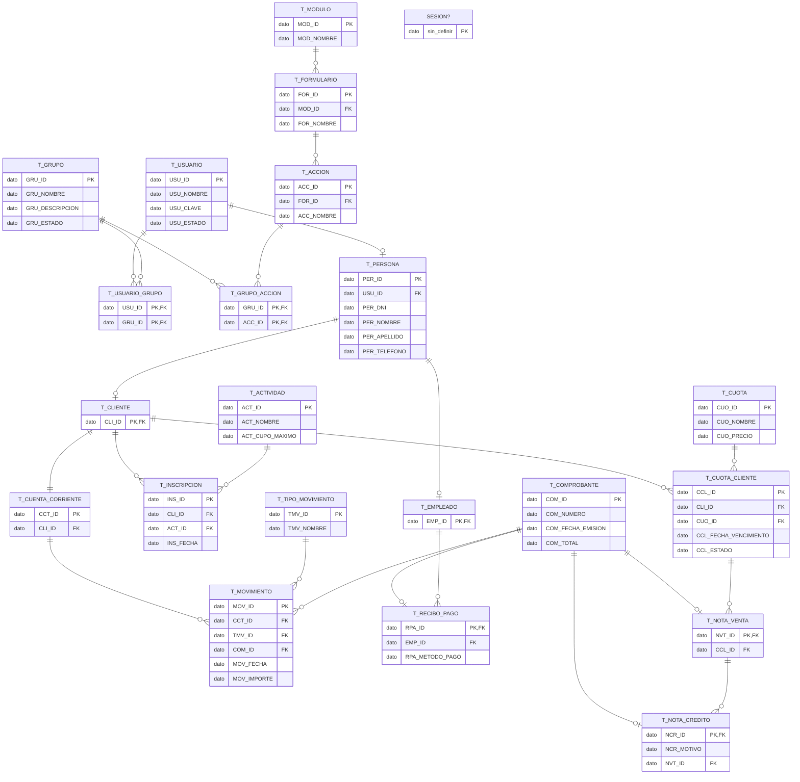

# Documentación de Modelos - Proyecto 2026

Este documento contiene los tres diagramas del sistema en bloques Mermaid independientes listos para renderizar:

1. **Modelo de Dominio** (`classDiagram`)
2. **Diagrama de Clases - Capas BE y DAL** (`classDiagram`)
3. **Diagrama Entidad-Relación - Base de Datos** (`erDiagram` con especializaciones corregidas)

---

## 1. Modelo de Dominio (Versión 2)

```mermaid
classDiagram
direction TB

namespace Modelo_de_Dominio {
    class DOM_PERSONA["PERSONA"] {
        -PER_ID: int
        -PER_DNI: int
        -PER_NOMBRE: string
        -PER_APELLIDO: string
        -PER_TELEFONO: string
        -PER_USUARIO: USUARIO[0..1]
    }

    class DOM_USUARIO["USUARIO"] {
        -USU_ID: int
        -USU_NOMBRE: string
        -USU_CLAVE: string
        -USU_ESTADO: string
    }

    class DOM_EMPLEADO["EMPLEADO"] {
        -EMP_ID: int
        -EMP_RECIBOS: RECIBO_PAGO[0..*]
    }

    class DOM_CLIENTE["CLIENTE"] {
        -CLI_ID: int
        -CLI_INSCRIPCIONES: INSCRIPCION[0..*]
        -CLI_CUOTAS: CUOTA_CLIENTE[0..*]
        -CLI_CUENTA: CUENTA CORRIENTE[0..1]
    }

    class DOM_SESION["SESION"] {
        -SES_ID: int
        -SES_FECHA_INICIO: datetime
        -SES_USUARIO: USUARIO[1]
        -SES_PERFIL: ACCION[0..*]
    }

    class DOM_SESION_SINGLETON["SESION"] {
        <<SINGLETON>>
        -SES_ID: int
        -SES_FECHA_INICIO: datetime
        -SES_USUARIO: USUARIO[1]
        -SES_PERFIL: ACCION[0..*]
        -SES_INSTANCIA: SESION
        -SESION()
        +ObtenerInstancia() SESION
        +IniciarSesion(usuario: USUARIO)
        +CerrarSesion()
    }

    class DOM_GRUPO["GRUPO"] {
        -GRU_ID: int
        -GRU_NOMBRE: string
        -GRU_DESCRIPCION: string
        -GRU_ESTADO: string
        -GRU_ACCIONES: ACCION[0..*]
    }

    class DOM_ACCION["ACCION"] {
        -ACC_ID: int
        -ACC_NOMBRE: string
        -ACC_FORM: FORMULARIO[1]
    }

    class DOM_FORMULARIO["FORMULARIO"] {
        -FOR_ID: int
        -FOR_NOMBRE: string
        -FOR_MODULO: MODULO[1]
        -FOR_ACCIONES_POSIBLES: ACCION[0..*]
    }

    class DOM_MODULO["MODULO"] {
        -MOD_ID: int
        -MOD_NOMBRE: string
    }

    class DOM_ACTIVIDAD["ACTIVIDAD"] {
        -ACT_ID: int
        -ACT_NOMBRE: string
        -ACT_CUPO_MAXIMO: int
        -ACT_INSCRIPCIONES: INSCRIPCION[0..*]
    }

    class DOM_INSCRIPCION["INSCRIPCION"] {
        -INS_ID: int
        -INS_FECHA: datetime
        -INS_CLIENTE: CLIENTE[1]
        -INS_ACTIVIDAD: ACTIVIDAD[1]
    }

    class DOM_CUOTA["CUOTA"] {
        -CUO_ID: int
        -CUO_NOMBRE: string
        -CUO_PRECIO: decimal
    }

    class DOM_CUOTA_CLIENTE["CUOTA_CLIENTE"] {
        -CCL_ID: int
        -CCL_FECHA_VENCIMIENTO: datetime
        -CCL_ESTADO: string
        -CCL_CLIENTE: CLIENTE[1]
        -CCL_CUOTA: CUOTA[1]
    }

    class DOM_CUENTA_CORRIENTE["CUENTA CORRIENTE"] {
        -CCT_ID: int
        -CCT_CLIENTE: CLIENTE[1]
        -CCT_MOVIMIENTOS: MOVIMIENTO[0..*]
    }

    class DOM_MOVIMIENTO["MOVIMIENTO"] {
        -MOV_ID: int
        -MOV_FECHA: datetime
        -MOV_IMPORTE: decimal
        -MOV_TIPO_MOVIMIENTO: TIPO_MOVIMIENTO[1]
        -MOV_COMPROBANTE: COMPROBANTE[1]
    }

    class DOM_TIPO_MOVIMIENTO["TIPO MOVIMIENTO"] {
        -TMV_ID: int
        -TMV_NOMBRE: string
    }

    class DOM_COMPROBANTE["COMPROBANTE"] {
        -COM_ID: int
        -COM_NUMERO: string
        -COM_FECHA_EMISION: datetime
        -COM_TOTAL: decimal
    }

    class DOM_RECIBO_PAGO["RECIBO PAGO"] {
        -RPA_ID: int
        -RPA_EMPLEADO: EMPLEADO[1]
        -RPA_METODO_PAGO: string
    }

    class DOM_NOTA_VENTA["NOTA VENTA"] {
        -NVT_ID: int
        -NVT_CUOTA_CLIENTE: CUOTA_CLIENTE[1]
    }

    class DOM_NOTA_CREDITO["NOTA CREDITO"] {
        -NCR_ID: int
        -NCR_MOTIVO: string
    }
}

note for DOM_SESION_SINGLETON "EMPLEADO CON ROL DE ADMINISTRADOR?\nLISTAS Y ESTADOS?"

%% Herencias del Dominio (NOTA VENTA, NOTA CREDITO y RECIBO PAGO heredan de COMPROBANTE)
DOM_EMPLEADO --|> DOM_PERSONA
DOM_CLIENTE --|> DOM_PERSONA
DOM_NOTA_VENTA --|> DOM_COMPROBANTE
DOM_NOTA_CREDITO --|> DOM_COMPROBANTE
DOM_RECIBO_PAGO --|> DOM_COMPROBANTE

%% Asociaciones y Agregaciones del Dominio
DOM_USUARIO "0..1" .. "1" DOM_PERSONA
DOM_SESION "0..*" -- "1" DOM_USUARIO
DOM_SESION_SINGLETON "1" --> "1" DOM_SESION_SINGLETON
DOM_USUARIO "0..*" -- "0..*" DOM_GRUPO
DOM_GRUPO "0..*" o-- "0..*" DOM_ACCION
DOM_ACCION "0..*" -- "1" DOM_FORMULARIO
DOM_FORMULARIO "0..*" -- "1" DOM_MODULO
DOM_ACCION "0..*" -- "0..*" DOM_USUARIO

DOM_CLIENTE "1" -- "0..*" DOM_INSCRIPCION
DOM_ACTIVIDAD "1" -- "0..*" DOM_INSCRIPCION
DOM_CLIENTE "1" -- "0..*" DOM_CUOTA_CLIENTE
DOM_CUOTA_CLIENTE "0..*" -- "1" DOM_CUOTA

DOM_CLIENTE "1" -- "0..1" DOM_CUENTA_CORRIENTE
DOM_CUENTA_CORRIENTE "1" *-- "0..*" DOM_MOVIMIENTO
DOM_MOVIMIENTO "0..*" -- "1" DOM_TIPO_MOVIMIENTO
DOM_MOVIMIENTO "0..*" -- "1" DOM_COMPROBANTE
DOM_EMPLEADO "1" -- "0..*" DOM_RECIBO_PAGO
DOM_CUOTA_CLIENTE "1" -- "0..*" DOM_NOTA_VENTA
DOM_NOTA_VENTA "1" -- "0..*" DOM_NOTA_CREDITO
```

---

## 2. Diagrama de Clases (Capas BE y DAL)

```mermaid
classDiagram
direction TB

namespace Capa_Entidades_BE {
    class PERSONA_BE {
        -PER_ID: int
        -PER_DNI: int
        -PER_NOMBRE: string
        -PER_APELLIDO: string
        -PER_TELEFONO: string
        -PER_USUARIO: USUARIO_BE
        +PER_ID: int «get; set;»
        +PER_DNI: int «get; set;»
        +PER_NOMBRE: string «get; set;»
        +PER_APELLIDO: string «get; set;»
        +PER_TELEFONO: string «get; set;»
        +PER_USUARIO: USUARIO_BE «get; set;»
    }

    class USUARIO_BE {
        -USU_ID: int
        -USU_NOMBRE: string
        -USU_CLAVE: string
        -USU_ESTADO: string
        +USU_ID: int «get; set;»
        +USU_NOMBRE: string «get; set;»
        +USU_CLAVE: string «get; set;»
        +USU_ESTADO: string «get; set;»
    }

    class EMPLEADO_BE {
        -EMP_ID: int
        -EMP_RECIBOS: RECIBO_PAGO_BE[0..*]
        +EMP_ID: int «get; set;»
    }

    class CLIENTE_BE {
        -CLI_ID: int
        -CLI_INSCRIPCIONES: List~INSCRIPCION_BE~
        -CLI_CUOTAS: List~CUOTA_CLIENTE_BE~
        -CLI_CUENTA: CUENTA_CORRIENTE_BE
        +CLI_ID() int «get; set;»
        +CLI_INSCRIPCIONES() List~INSCRIPCION_BE~ «get; set;»
        +CLI_CUOTAS() List~CUOTA_CLIENTE_BE~ «get; set;»
        +CLI_CUENTA: CUENTA_CORRIENTE_BE «get; set;»
    }

    class ACTIVIDAD_BE {
        -ACT_ID: int
        -ACT_NOMBRE: string
        -ACT_CUPO_MAXIMO: int
        -ACT_INSCRIPCIONES: INSCRIPCION[0..*]
        +ACT_ID: int «get; set;»
        +ACT_NOMBRE: string «get; set;»
        +ACT_CUPO_MAXIMO: int «get; set;»
        +ACT_INSCRIPCIONES: List~INSCRIPCION_BE~ «get; set;»
    }

    class INSCRIPCION_BE {
        -INS_ID: int
        -INS_FECHA: datetime
        -INS_CLIENTE: CLIENTE[1]
        -INS_ACTIVIDAD: ACTIVIDAD[1]
        +INS_ID: int «get; set;»
        +INS_FECHA: DateTime «get; set;»
        +INS_CLIENTE: CLIENTE_BE «get; set;»
        +INS_ACTIVIDAD: ACTIVIDAD_BE «get; set;»
    }

    class CUOTA_BE {
        -CUO_ID: int
        -CUO_NOMBRE: string
        -CUO_PRECIO: decimal
        +CUO_ID() int «get; set;»
        +CUO_NOMBRE() string «get; set;»
        +CUO_PRECIO() decimal «get; set;»
    }

    class CUOTA_CLIENTE_BE {
        -CCL_ID: int
        -CCL_FECHA_VENCIMIENTO: DateTime?
        -CCL_ESTADO: string?
        -CCL_CLIENTE: CLIENTE_BE
        -CCL_CUOTA: CUOTA_BE
        +CCL_ID() int «get; set;»
        +CCL_FECHA_VENCIMIENTO: DateTime?
        +CCL_ESTADO() string? «get; set;»
        +CCL_CLIENTE() CLIENTE_BE «get; set;»
        +CCL_CUOTA() CUOTA_BE «get; set;»
    }

    class CUENTA_CORRIENTE_BE {
        -CCT_ID: int
        -CCT_CLIENTE: CLIENTE_BE
        -CCT_MOVIMIENTOS: List~MOVIMIENTO_BE~
        +CCT_ID: int «get; set;»
        +CCT_CLIENTE: CLIENTE_BE «get; set;»
        +CCT_MOVIMIENTOS: List~MOVIMIENTO_BE~ «get; set;»
    }

    class MOVIMIENTO_BE {
        -MOV_ID: int
        -MOV_FECHA: DateTime
        -MOV_IMPORTE: decimal
        -MOV_TIPO_MOVIMIENTO: TIPO_MOVIMIENTO_BE
        -MOV_COMPROBANTE: COMPROBANTE_BE
        +MOV_ID: int «get; set;»
        +MOV_FECHA: DateTime «get; set;»
        +MOV_IMPORTE: decimal «get; set;»
        +MOV_TIPO_MOVIMIENTO: TIPO_MOVIMIENTO_BE «get; set;»
        +MOV_COMPROBANTE: COMPROBANTE_BE «get; set;»
    }

    class TIPO_MOVIMIENTO_BE {
        -TMV_ID: int
        -TMV_NOMBRE: string
        +TMV_ID: int «get; set;»
        +TMV_NOMBRE: string «get; set;»
    }

    class COMPROBANTE_BE {
        -COM_ID: int
        -COM_NUMERO: string
        -COM_FECHA_EMISION: DateTime
        -COM_TOTAL: decimal
        +COM_ID: int «get; set;»
        +COM_NUMERO: string «get; set;»
        +COM_FECHA_EMISION: DateTime «get; set;»
        +COM_TOTAL: decimal «get; set;»
    }

    class RECIBO_PAGO_BE {
        -RPA_ID: int
        -RPA_EMPLEADO: EMPLEADO_BE
        -RPA_METODO_PAGO: string
        +RPA_ID: int «get; set;»
        +RPA_EMPLEADO: EMPLEADO_BE «get; set;»
        +RPA_METODO_PAGO: string «get; set;»
    }

    class NOTA_VENTA_BE {
        -NVT_ID: int
        -NVT_CUOTA_CLIENTE: CUOTA_CLIENTE_BE
        +NVT_ID: int «get; set;»
        +NVT_CUOTA_CLIENTE: CUOTA_CLIENTE_BE «get; set;»
    }

    class NOTA_CREDITO_BE {
        -NCR_ID: int
        -NCR_MOTIVO: string
        -NCR_NOTA_VENTA: NOTA_VENTA_BE
        +NCR_ID: int «get; set;»
        +NCR_MOTIVO: string «get; set;»
        +NCR_NOTA_VENTA: NOTA_VENTA_BE «get; set;»
    }
}

namespace Capa_Datos_DAL {
    class USUARIO_DAL {
        -USU_LISTA_USUARIOS: USUARIO_BE[0..*]
        +getAllUsuarios() USUARIO_BE[0..*]
        +getUsuarioById(id: int) USUARIO_BE
        +addUsuario(oU: USUARIO_BE) bool
    }

    class EMPLEADO_DAL {
        -EMP_LISTA_EMPLEADOS: EMPLEADO_BE[0..*]
        +getEmpleadoByID(id: int) EMPLEADO_BE
    }

    class CLIENTE_DAL {
        -CLI_LISTA_CLIENTES: CLIENTE_BE[0..*]
        +getAllClientes() CLIENTE_BE[0..*]
        +getClienteByDNI(dni: int) CLIENTE_BE
        +addCliente(oC: CLIENTE_BE) bool
        +updateCliente(oC: CLIENTE_BE) bool
    }

    class ACTIVIDAD_DAL {
        -ACT_LISTA_ACTIVIDADES: ACTIVIDAD_BE[0..*]
        +getAllActividades() ACTIVIDAD_BE[0..*]
        +updateCupo(id: int, cupoRestante: int) bool
    }

    class INSCRIPCION_DAL {
        -INS_LISTA_INSCRIPCIONES: INSCRIPCION_BE[0..*]
        +saveInscripcion(oI: INSCRIPCION_BE) bool
        +getInscripcionesByActividad(actId: int) INSCRIPCION_BE[0..*]
        +getInscripcionesByCliente(cliId: int) List~INSCRIPCION_BE~
    }

    class CUOTA_DAL {
        -CUO_LISTA_CUOTAS: CUOTA_BE[0..*]
        +getAllCuotas() CUOTA_BE[0..*]
        +getCuotaById(id: int) CUOTA_BE
    }

    class CUOTA_CLIENTE_DAL {
        -CCL_LISTA_CUOTAS_CLIENTES: CUOTA_CLIENTE_BE[0..*]
        +addCuotaCliente(oCcl: CUOTA_CLIENTE_BE) bool
        +getCuotasByCliente(cliId: int) CUOTA_CLIENTE_BE[0..*]
        +updateEstadoCuota(cclId: int, nuevoEstado: string) bool
        +getCuotaActivaByCliente(cliId: int) CUOTA_CLIENTE_BE
    }

    class CUENTA_CORRIENTE_DAL {
        -CCT_LISTA_CUENTAS: CUENTA_CORRIENTE_BE[0..*]
        +getCuentaByClienteId(id: int) CUENTA_CORRIENTE_BE
        +addCuenta(c: CUENTA_CORRIENTE_BE) bool
    }

    class MOVIMIENTO_DAL {
        -MOV_LISTA_MOVIMIENTOS: MOVIMIENTO_BE[0..*]
        +addMovimiento(m: MOVIMIENTO_BE) bool
        +getMovimientosByCuentaId(id: int) List~MOVIMIENTO_BE~
    }

    class TIPO_MOVIMIENTO_DAL {
        -TMV_LISTA_TIPOS: TIPO_MOVIMIENTO_BE[0..*]
        +getTiposMovimiento() List~TIPO_MOVIMIENTO_BE~
    }

    class COMPROBANTE_DAL {
        -COM_LISTA_COMPROBANTES: COMPROBANTE_BE[0..*]
        +addNotaVenta(n: NOTA_VENTA_BE) bool
        +addReciboPago(r: RECIBO_PAGO_BE) bool
        +addNotaCredito(n: NOTA_CREDITO_BE) bool
        +getComprobanteById(id: int) COMPROBANTE_BE
        +getNotaVentaByClienteYPeriodo(cliId: int, periodo: DateTime) NOTA_VENTA_BE
    }
}

%% Herencia en BE (NOTA_VENTA_BE, RECIBO_PAGO_BE y NOTA_CREDITO_BE heredan de COMPROBANTE_BE)
EMPLEADO_BE --|> PERSONA_BE
CLIENTE_BE --|> PERSONA_BE
NOTA_VENTA_BE --|> COMPROBANTE_BE
RECIBO_PAGO_BE --|> COMPROBANTE_BE
NOTA_CREDITO_BE --|> COMPROBANTE_BE

%% Asociaciones y Composiciones BE
USUARIO_BE "0..1" .. "1" PERSONA_BE
CLIENTE_BE "1" -- "0..*" INSCRIPCION_BE
INSCRIPCION_BE "0..*" -- "1" ACTIVIDAD_BE
CLIENTE_BE "1" -- "0..*" CUOTA_CLIENTE_BE
CUOTA_CLIENTE_BE "0..*" -- "1" CUOTA_BE
CLIENTE_BE "1" -- "0..1" CUENTA_CORRIENTE_BE
CUENTA_CORRIENTE_BE "1" *-- "0..*" MOVIMIENTO_BE
MOVIMIENTO_BE "0..*" -- "1" TIPO_MOVIMIENTO_BE
MOVIMIENTO_BE "0..*" -- "1" COMPROBANTE_BE
EMPLEADO_BE "1" -- "0..*" RECIBO_PAGO_BE
CUOTA_CLIENTE_BE "1" -- "0..*" NOTA_VENTA_BE
NOTA_CREDITO_BE "0..*" -- "1" NOTA_VENTA_BE

%% Relaciones BE <-> DAL
USUARIO_DAL "1" o-- "0..*" USUARIO_BE
EMPLEADO_BE "0..*" --o "1" EMPLEADO_DAL
CLIENTE_DAL "1" o-- "0..*" CLIENTE_BE
ACTIVIDAD_BE "0..*" --o "1" ACTIVIDAD_DAL
INSCRIPCION_DAL "1" o-- "0..*" INSCRIPCION_BE
CUOTA_BE "0..*" --o "1" CUOTA_DAL
CUOTA_CLIENTE_DAL "1" o-- "0..*" CUOTA_CLIENTE_BE
CUENTA_CORRIENTE_DAL "0..*" --o "1" CUENTA_CORRIENTE_BE
MOVIMIENTO_BE "1" o-- "0..*" MOVIMIENTO_DAL
TIPO_MOVIMIENTO_BE "1" o-- "0..*" TIPO_MOVIMIENTO_DAL
COMPROBANTE_BE "1" o-- "0..*" COMPROBANTE_DAL
```

---

## 3. Diagrama Entidad-Relación (Base de Datos)

